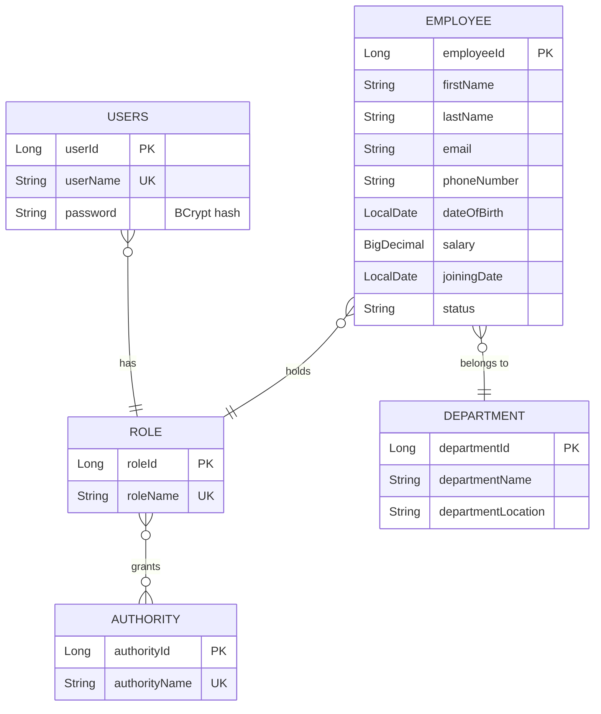

# AeroOps

**A secure, role-based operations backend for aviation enterprises, built with Spring Boot, PostgreSQL and JWT.**


AeroOps is a final-year Computer Engineering capstone. It is the core platform for an AI-assisted flight and enterprise operations system. This repository currently contains the **core backend**: workforce management (employees, departments, roles) protected by stateless JWT authentication and fine-grained, authority-based authorization. The AI components are planned and listed under [Roadmap](#roadmap).

---

## Features

- **Stateless JWT authentication.** Login issues a signed token (JJWT, HMAC); a custom filter validates it on every request. No server-side sessions.
- **Role and authority based access control.** Users have a role, roles hold authorities (`EMPLOYEE_CREATE`, `EMPLOYEE_READ`, `EMPLOYEE_UPDATE`, `EMPLOYEE_DELETE`), and endpoints are guarded per authority.
- **Employee management REST API** with pagination, sorting and dynamic filtering by status, department and role (JPA Specifications).
- **Clean layered architecture:** Controller → Service → Repository, with DTOs and dedicated mappers so entities never leak through the API.
- **Bean validation** on request payloads, with a structured JSON error format.
- **Consistent error handling.** A global exception handler plus custom `401 Unauthorized` and `403 Forbidden` handlers return the same JSON shape.
- **Self-seeding security data.** On startup, authorities, roles and demo users are created if missing (idempotent).
- **Containerized.** Multi-stage Dockerfile and a Docker Compose stack (app + PostgreSQL with a named volume).
- **Database backup.** A `pg_dump` snapshot of the schema and sample data is included.

## Tech stack

| Layer | Technology |
|---|---|
| Language / runtime | Java 17 (Docker images run on Eclipse Temurin 25) |
| Framework | Spring Boot 4.1.0 (Spring Web MVC) |
| Persistence | Spring Data JPA, Hibernate, PostgreSQL |
| Security | Spring Security, JJWT 0.13.0, BCrypt |
| Validation | Jakarta Bean Validation |
| Build | Maven |
| Containers | Docker (multi-stage build), Docker Compose |

## Architecture

```
Client
  │  Authorization: Bearer <JWT>
  ▼
JwtAuthenticationFilter ──► validates token, loads user + authorities
  │
  ▼
SecurityFilterChain ──► per-endpoint authority checks (401 / 403 handled as JSON)
  │
  ▼
Controller ──► Service ──► Repository ──► PostgreSQL
 (DTO in)     (rules)     (JPA /          
                           Specifications)
```

### Data model



### Default roles

| Role | Authorities |
|---|---|
| `ADMIN` | `EMPLOYEE_CREATE`, `EMPLOYEE_READ`, `EMPLOYEE_UPDATE`, `EMPLOYEE_DELETE` |
| `MANAGER` | `EMPLOYEE_CREATE`, `EMPLOYEE_READ` |
| `EMPLOYEE` | `EMPLOYEE_READ` |

Three demo users (one per role) are seeded on first startup by `SecurityDataInitializer`. Their credentials are defined in that class. **They are for local development only; change or remove them before any real deployment.**

## API reference

All endpoints except login require the header `Authorization: Bearer <token>`.

### Authentication

| Method | Endpoint | Access | Description |
|---|---|---|---|
| `POST` | `/auth/login` | Public | Authenticate with `username` and `password`; returns a JWT as plain text |

Tokens expire after 5 minutes by default (`jwt.expiration`, in milliseconds).

### Employees: `/api/v1/employees`

| Method | Endpoint | Required authority | Description |
|---|---|---|---|
| `GET` | `/api/v1/employees` | `EMPLOYEE_READ` | Paginated list. Query params: `page`, `size` (default 10), `sort` (default `employeeId`), `status`, `departmentId`, `roleId` |
| `GET` | `/api/v1/employees/{id}` | Any authenticated user | Get one employee |
| `POST` | `/api/v1/employees` | `EMPLOYEE_CREATE` | Create an employee (validated) |
| `PUT` | `/api/v1/employees/{id}` | `EMPLOYEE_UPDATE` | Update an employee (validated) |
| `DELETE` | `/api/v1/employees/{id}` | `EMPLOYEE_DELETE` | Delete an employee |

### Departments: `/api/v1/department`

| Method | Endpoint | Description |
|---|---|---|
| `GET` | `/api/v1/department` | List departments |
| `POST` | `/api/v1/department` | Create a department |
| `PUT` | `/api/v1/department/{id}` | Update a department |
| `DELETE` | `/api/v1/department/{id}` | Delete a department |

### Roles: `/api/v1/role`

| Method | Endpoint | Description |
|---|---|---|
| `GET` | `/api/v1/role` | List roles |
| `GET` | `/api/v1/role/{id}` | Get one role |
| `POST` | `/api/v1/role` | Create a role |
| `PUT` | `/api/v1/role/{id}` | Rename a role |

Department and role endpoints currently require authentication only (any valid token).

### Error format

Validation, not-found, `401` and `403` errors all share one shape:

```json
{
  "timestamp": "2026-10-13T18:30:00.123",
  "status": 400,
  "message": "Validation Failed",
  "errors": {
    "firstName": "Name should be atleast of 5 letters and less than 20 letters"
  }
}
```

## Getting started

### Prerequisites

- Docker and Docker Compose, **or** JDK 17+, Maven 3.9+ and a local PostgreSQL instance

### Option 1: Docker Compose

```bash
cd spring-core-demo

# Build the application image (the compose file expects this tag)
docker build -f Dockerfile.multistage -t aeroops:multistage-test .

# Start the app and PostgreSQL
docker compose up
```

The API is then available at `http://localhost:8080`. Database data persists in the `aeroops-postgres-data` volume. If the app exits because PostgreSQL was not ready yet, run `docker compose up app` again.

### Option 2: Run locally

1. Create a PostgreSQL database named `aeroops`.
2. Make sure the datasource settings in `src/main/resources/application.properties` match your database (host defaults to `localhost`, override with `DB_HOST`).
3. Start the app:

```bash
cd spring-core-demo
mvn spring-boot:run
```

Tables are created automatically (`spring.jpa.hibernate.ddl-auto=update`) and the roles, authorities and demo users are seeded on first start.

### Configuration

Spring Boot lets environment variables override `application.properties`, so secrets do not need to live in the file:

| Setting | Property | Environment variable |
|---|---|---|
| Database host | `spring.datasource.url` (uses `DB_HOST`) | `DB_HOST` |
| Database password | `spring.datasource.password` | `SPRING_DATASOURCE_PASSWORD` |
| JWT signing key (Base64) | `jwt.secret` | `JWT_SECRET` |
| Token lifetime (ms) | `jwt.expiration` | `JWT_EXPIRATION` |

### Try it

```bash
# 1. Log in with one of the seeded users (see SecurityDataInitializer) and capture the token
TOKEN=$(curl -s -X POST http://localhost:8080/auth/login \
  -H "Content-Type: application/json" \
  -d '{"username":"<seeded-username>","password":"<seeded-password>"}')

# 2. List employees (page 0, 5 per page, only ACTIVE)
curl "http://localhost:8080/api/v1/employees?page=0&size=5&status=ACTIVE" \
  -H "Authorization: Bearer $TOKEN"

# 3. Create an employee (requires EMPLOYEE_CREATE)
curl -X POST http://localhost:8080/api/v1/employees \
  -H "Authorization: Bearer $TOKEN" \
  -H "Content-Type: application/json" \
  -d '{
        "firstName": "Rakesh",
        "lastName": "Sharma",
        "email": "rakesh.sharma@example.com",
        "phoneNumber": "9876543210",
        "dateOfBirth": "1995-04-12",
        "salary": 65000,
        "joiningDate": "2026-01-15",
        "status": "ACTIVE",
        "departmentId": 1,
        "roleId": 3
      }'
```

A `403 Forbidden` on step 3 for the lowest-privilege user is the authorization layer working as intended.

### Backup and restore

`spring-core-demo/aeroops-backup.sql` is a `pg_dump` snapshot of the schema and sample data. The file is UTF-16 encoded, so convert it before restoring:

```bash
iconv -f UTF-16 -t UTF-8 aeroops-backup.sql > aeroops-backup-utf8.sql
psql -U postgres -d aeroops -f aeroops-backup-utf8.sql
```

## Project structure

```
AeroOps/
└── spring-core-demo/
    ├── Dockerfile / Dockerfile.multistage
    ├── compose.yaml
    ├── aeroops-backup.sql
    ├── pom.xml
    └── src/main/java/com/aeroops/springdemo/
        ├── config/          Security filter chain, password encoder, auth provider
        ├── controller/      REST controllers (auth, employee, department, role)
        ├── dto/             Request / response objects and the error payload
        ├── entity/          JPA entities (Employee, Department, Role, Authority, User)
        ├── exception/       Domain exceptions and the global exception handler
        ├── initializer/     Startup seeding of authorities, roles and demo users
        ├── mapper/          Entity ↔ DTO mappers
        ├── repository/      Spring Data JPA repositories
        ├── security/        JWT filter, user details, 401 / 403 handlers
        ├── service/         Business logic and JWT generation / validation
        └── specification/   Dynamic employee filters (JPA Specifications)
```

## Roadmap

These are **planned and not yet implemented**:

- Aviation domain model: flights, aircraft, crew, weather snapshots
- Flight delay prediction microservice (Python, FastAPI, XGBoost)
- RAG-based natural-language Ops Assistant (pgvector, agentic tool-calling)
- Redis caching and Resilience4j fault tolerance around the AI gateway
- React frontend with a role-based dashboard
- Automated test coverage beyond the context-load test, and a CI pipeline
- Cloud deployment on AWS

## Author

**Tejas**, final-year Computer Engineering student.
[GitHub](https://github.com/tejas1598)
