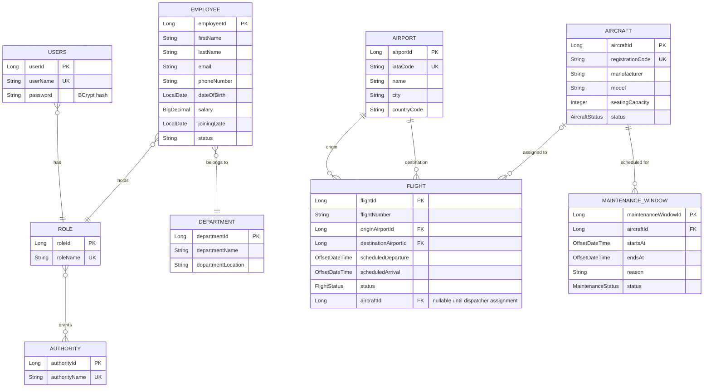

# AeroOps

**A learning project for airline operations: maintain aircraft readiness and build toward safe assignment to scheduled flights.**


AeroOps is a final-year Computer Engineering learning project built with Spring Boot, PostgreSQL, and JWT. Its target workflow is to register aircraft, track readiness, schedule flights, and prevent assigning an unavailable aircraft. The existing employee administration API remains in place while the aviation domain is added in small, reviewable milestones. See the [build flow](docs/BUILD_FLOW.md) for the maintained plan.

---

## Features

- **Stateless JWT authentication.** Login issues a signed token (JJWT, HMAC); a custom filter validates it on every request. No server-side sessions.
- **Role and authority based access control.** Users have a role, roles hold authorities (`EMPLOYEE_CREATE`, `EMPLOYEE_READ`, `EMPLOYEE_UPDATE`, `EMPLOYEE_DELETE`), and endpoints are guarded per authority.
- **Employee management REST API** with pagination, sorting and dynamic filtering by status, department and role (JPA Specifications).
- **Aircraft registry (first aviation milestone).** Register, list, inspect, and update aircraft, including a separate readiness status operation.
- **Airport registry and flight scheduling.** Use unique three-letter airport codes, schedule flights between distinct airports, and reject invalid time ranges or duplicate flight-number/departure pairs.
- **Maintenance planning.** Schedule and cancel aircraft maintenance windows; the API prevents conflicts with assigned flights and other scheduled maintenance.
- **Clean layered architecture:** Controller → Service → Repository, with DTOs and dedicated mappers so entities never leak through the API.
- **Bean validation** on request payloads, with a structured JSON error format.
- **Consistent error handling.** A global exception handler plus custom `401 Unauthorized` and `403 Forbidden` handlers return the same JSON shape.
- **Self-seeding security data.** On startup, authorities, roles and demo users are created if missing (idempotent).
- **Containerized.** Multi-stage Dockerfile and a Docker Compose stack (app + PostgreSQL with a named volume).
- **Database backup.** A `pg_dump` snapshot of the schema and sample data is included.

## Tech stack

| Layer | Technology |
|---|---|
| Language / runtime | Java 17 (Docker images run on Eclipse Temurin 25) |
| Framework | Spring Boot 4.1.0 (Spring Web MVC) |
| Persistence | Spring Data JPA, Hibernate, PostgreSQL |
| Security | Spring Security, JJWT 0.13.0, BCrypt |
| Validation | Jakarta Bean Validation |
| Build | Maven |
| Containers | Docker (multi-stage build), Docker Compose |

## Architecture

```
Client
  │  Authorization: Bearer <JWT>
  ▼
JwtAuthenticationFilter ──► validates token, loads user + authorities
  │
  ▼
SecurityFilterChain ──► per-endpoint authority checks (401 / 403 handled as JSON)
  │
  ▼
Controller ──► Service ──► Repository ──► PostgreSQL
 (DTO in)     (rules)     (JPA /          
                           Specifications)
```

### Data model



### Default roles

| Role | Authorities |
|---|---|
| `ADMIN` | Full employee, aircraft, airport, flight, and maintenance-window management |
| `MANAGER` | Employee create/read; aircraft and airport read; flight read/schedule/update/assign/status update; maintenance read |
| `EMPLOYEE` | Employee, aircraft, airport, and flight read |
| `MAINTENANCE_TECH` | Aircraft status update; aircraft, airport, flight, and maintenance read; schedule/cancel maintenance windows |

Three demo users are seeded on first startup by `SecurityDataInitializer`; the maintenance technician role is available but has no demo account. Demo credentials are defined in that class. **They are for local development only; change or remove them before any real deployment.**

## API reference

All endpoints except login require the header `Authorization: Bearer <token>`.

### Authentication

| Method | Endpoint | Access | Description |
|---|---|---|---|
| `POST` | `/auth/login` | Public | Authenticate with `username` and `password`; returns a JWT as plain text |

Tokens expire after 5 minutes by default (`jwt.expiration`, in milliseconds).

### Employees: `/api/v1/employees`

| Method | Endpoint | Required authority | Description |
|---|---|---|---|
| `GET` | `/api/v1/employees` | `EMPLOYEE_READ` | Paginated list. Query params: `page`, `size` (default 10), `sort` (default `employeeId`), `status`, `departmentId`, `roleId` |
| `GET` | `/api/v1/employees/{id}` | Any authenticated user | Get one employee |
| `POST` | `/api/v1/employees` | `EMPLOYEE_CREATE` | Create an employee (validated) |
| `PUT` | `/api/v1/employees/{id}` | `EMPLOYEE_UPDATE` | Update an employee (validated) |
| `DELETE` | `/api/v1/employees/{id}` | `EMPLOYEE_DELETE` | Delete an employee |

### Aircraft: `/api/v1/aircraft`

| Method | Endpoint | Required authority | Description |
|---|---|---|---|
| `GET` | `/api/v1/aircraft` | `AIRCRAFT_READ` | Paginated aircraft registry |
| `GET` | `/api/v1/aircraft/{id}` | `AIRCRAFT_READ` | Get one aircraft |
| `POST` | `/api/v1/aircraft` | `AIRCRAFT_CREATE` | Register aircraft (starts `READY`) |
| `PUT` | `/api/v1/aircraft/{id}` | `AIRCRAFT_UPDATE` | Update registration, manufacturer, model, or capacity |
| `PATCH` | `/api/v1/aircraft/{id}/status` | `AIRCRAFT_STATUS_UPDATE` | Change readiness to `READY`, `IN_MAINTENANCE`, or `RETIRED` |

Duplicate registration codes return `409 Conflict`; unknown aircraft IDs return `404 Not Found`.

### Airports: `/api/v1/airports`

| Method | Endpoint | Required authority | Description |
|---|---|---|---|
| `GET` | `/api/v1/airports` | `AIRPORT_READ` | Paginated airport list |
| `GET` | `/api/v1/airports/{id}` | `AIRPORT_READ` | Get one airport |
| `POST` | `/api/v1/airports` | `AIRPORT_CREATE` | Create an airport with a unique IATA code |
| `PUT` | `/api/v1/airports/{id}` | `AIRPORT_UPDATE` | Update airport details |

Airport codes are normalized to uppercase. Duplicate codes return `409 Conflict`.

### Flights: `/api/v1/flights`

| Method | Endpoint | Required authority | Description |
|---|---|---|---|
| `GET` | `/api/v1/flights` | `FLIGHT_READ` | Paginated flight schedule, default sorted by departure |
| `GET` | `/api/v1/flights/{id}` | `FLIGHT_READ` | Get one scheduled flight |
| `POST` | `/api/v1/flights` | `FLIGHT_SCHEDULE` | Schedule a flight between two airports |
| `PUT` | `/api/v1/flights/{id}` | `FLIGHT_UPDATE` | Update a scheduled flight |
| `PUT` | `/api/v1/flights/{id}/aircraft` | `FLIGHT_ASSIGN` | Assign a ready aircraft if no other flight overlaps |
| `PATCH` | `/api/v1/flights/{id}/status` | `FLIGHT_STATUS_UPDATE` | Move a flight through an allowed operational transition |

Departure and arrival use ISO-8601 offset date-time values (for example, `2027-05-15T09:00:00+05:30`). A flight must have different origin and destination airports, and arrival must be after departure. A flight number can be reused at another departure time. Assignment checks aircraft readiness and overlapping non-cancelled flight windows while locking the flight and aircraft rows. Aircraft under maintenance or retired cannot be assigned. An aircraft with an active flight cannot be taken out of service.

Flight status transitions are `SCHEDULED` → `BOARDING` → `IN_AIR` → `LANDED`, with cancellation allowed from `SCHEDULED` or `BOARDING`. A flight needs an assigned, ready aircraft before boarding or departure. `LANDED` and `CANCELLED` are terminal states; invalid transitions return `409 Conflict`.

### Maintenance windows: `/api/v1/maintenance-windows`

| Method | Endpoint | Required authority | Description |
|---|---|---|---|
| `GET` | `/api/v1/maintenance-windows` | `MAINTENANCE_READ` | Paginated windows; optional `aircraftId` filter |
| `GET` | `/api/v1/maintenance-windows/{id}` | `MAINTENANCE_READ` | Get one window |
| `POST` | `/api/v1/maintenance-windows` | `MAINTENANCE_MANAGE` | Schedule a window for an aircraft |
| `PATCH` | `/api/v1/maintenance-windows/{id}/cancel` | `MAINTENANCE_MANAGE` | Cancel a future scheduled window |

Maintenance windows require an aircraft, reason, and ISO-8601 offset start/end times. End must be after start. AeroOps rejects windows that overlap an assigned non-cancelled flight or another scheduled window for that aircraft. Flight assignment and schedule edits also reject overlap with a scheduled maintenance window. Cancellation is recorded as a state change and is allowed only before the window starts.

### Departments: `/api/v1/department`

| Method | Endpoint | Description |
|---|---|---|
| `GET` | `/api/v1/department` | List departments |
| `POST` | `/api/v1/department` | Create a department |
| `PUT` | `/api/v1/department/{id}` | Update a department |
| `DELETE` | `/api/v1/department/{id}` | Delete a department |

### Roles: `/api/v1/role`

| Method | Endpoint | Description |
|---|---|---|
| `GET` | `/api/v1/role` | List roles |
| `GET` | `/api/v1/role/{id}` | Get one role |
| `POST` | `/api/v1/role` | Create a role |
| `PUT` | `/api/v1/role/{id}` | Rename a role |

Department and role endpoints currently require authentication only (any valid token).

### Error format

Validation, not-found, `401` and `403` errors all share one shape:

```json
{
  "timestamp": "2026-10-13T18:30:00.123",
  "status": 400,
  "message": "Validation Failed",
  "errors": {
    "firstName": "Name should be atleast of 5 letters and less than 20 letters"
  }
}
```

## Getting started

### Prerequisites

- Docker and Docker Compose, **or** JDK 17+, Maven 3.9+ and a local PostgreSQL instance

### Option 1: Full stack with Docker Compose

```bash
# If you do not already have it, copy the safe template once and fill in local values:
cp spring-core-demo/.env.example spring-core-demo/.env

# Start the frontend, backend, and PostgreSQL container:
docker compose --env-file spring-core-demo/.env up --build
```

Open the frontend at `http://localhost:3000`. The backend API is also available directly at `http://localhost:8082` (the host port can be changed if needed). PostgreSQL runs in its own container and is mapped to host port `5433`, so it can run alongside a local PostgreSQL server using port `5432`. The named `aeroops-postgres-data` volume keeps the container database data when the containers are stopped or recreated. This is a fresh database; it does not automatically copy rows from your existing local database.

The local secrets file `spring-core-demo/.env` is ignored by Git. The tracked `spring-core-demo/.env.example` contains safe placeholders only. Do not commit `.env`. Generate a JWT signing key with `openssl rand -base64 32` and put it in `JWT_SECRET`. If you need the existing local database records in the container, export and restore them separately with PostgreSQL backup tools.

### Option 2: Run locally

1. Create a PostgreSQL database named `aeroops-featured` (or set `DB_NAME` to the database you already use).
2. Set `DB_USERNAME`, `DB_PASSWORD`, `DB_HOST`, `DB_NAME`, and `JWT_SECRET` in your run configuration or local ignored `.env` file. The host defaults to `localhost`.
3. Start the app:

```bash
cd spring-core-demo
mvn spring-boot:run
```

Tables are created automatically (`spring.jpa.hibernate.ddl-auto=update`) and the roles, authorities and demo users are seeded on first start.

### Configuration

Spring Boot lets environment variables override `application.properties`, so secrets do not need to live in the file:

| Setting | Property | Environment variable |
|---|---|---|
| Database host | `spring.datasource.url` (uses `DB_HOST`) | `DB_HOST` |
| Database name | `spring.datasource.url` | `DB_NAME` (defaults to `POSTGRES_DB`, then `aeroops-featured`) |
| Database username | `spring.datasource.username` | `DB_USERNAME` (defaults to `POSTGRES_USER`, then `postgres`) |
| Database password | `spring.datasource.password` | `DB_PASSWORD` (defaults to `POSTGRES_PASSWORD`) |
| JWT signing key (Base64) | `jwt.secret` | `JWT_SECRET` |
| Token lifetime (ms) | `jwt.expiration` | `JWT_EXPIRATION` |

### Try it

```bash
# 1. Log in with one of the seeded users (see SecurityDataInitializer) and capture the token
TOKEN=$(curl -s -X POST http://localhost:8080/auth/login \
  -H "Content-Type: application/json" \
  -d '{"username":"<seeded-username>","password":"<seeded-password>"}')

# 2. List employees (page 0, 5 per page, only ACTIVE)
curl "http://localhost:8080/api/v1/employees?page=0&size=5&status=ACTIVE" \
  -H "Authorization: Bearer $TOKEN"

# 3. Create an employee (requires EMPLOYEE_CREATE)
curl -X POST http://localhost:8080/api/v1/employees \
  -H "Authorization: Bearer $TOKEN" \
  -H "Content-Type: application/json" \
  -d '{
        "firstName": "Rakesh",
        "lastName": "Sharma",
        "email": "rakesh.sharma@example.com",
        "phoneNumber": "9876543210",
        "dateOfBirth": "1995-04-12",
        "salary": 65000,
        "joiningDate": "2026-01-15",
        "status": "ACTIVE",
        "departmentId": 1,
        "roleId": 3
      }'
```

A `403 Forbidden` on step 3 for the lowest-privilege user is the authorization layer working as intended.

### Backup and restore

`spring-core-demo/aeroops-backup.sql` is a `pg_dump` snapshot of the schema and sample data. The file is UTF-16 encoded, so convert it before restoring:

```bash
iconv -f UTF-16 -t UTF-8 aeroops-backup.sql > aeroops-backup-utf8.sql
psql -U postgres -d aeroops -f aeroops-backup-utf8.sql
```

## Project structure

Aviation code is grouped by feature. Each feature keeps its controller, service, repository, entities, DTOs, mapper, and exceptions together. The original workforce and security features remain in their existing shared folders.

The React frontend provides sign-in, flight scheduling, aircraft assignment and status updates, plus aircraft, airport, and maintenance screens. See [frontend/README.md](frontend/README.md) for local setup and [docs/FRONTEND_BACKEND_FLOW.md](docs/FRONTEND_BACKEND_FLOW.md) for how browser requests reach the API in development and Docker.

```
AeroOps/
├── frontend/                 React + Vite flight operations UI
└── spring-core-demo/
    ├── compose.yaml
    ├── pom.xml
    └── src/
        ├── main/java/com/aeroops/springdemo/
        │   ├── aircraft/
        │   │   ├── controller/  AircraftController
        │   │   ├── dto/         Aircraft request and response DTOs
        │   │   ├── entity/      Aircraft and AircraftStatus
        │   │   ├── exception/   Aircraft domain errors
        │   │   ├── mapper/      AircraftMapper
        │   │   ├── repository/  AircraftRepository
        │   │   └── service/     AircraftService
        │   ├── airport/         Airport feature, with the same layer folders
        │   ├── flight/          Flight feature, with the same layer folders
        │   ├── maintenance/     Maintenance feature, with the same layer folders
        │   ├── controller/      Existing employee, role, department, and auth APIs
        │   ├── service/         Existing workforce and JWT services
        │   ├── repository/      Existing workforce and security repositories
        │   ├── entity/          Existing workforce and security entities
        │   ├── dto/             Existing workforce and auth DTOs
        │   ├── mapper/          Existing workforce mappers
        │   ├── config/          Spring Security configuration
        │   ├── security/        JWT filter and security handlers
        │   └── exception/       Shared workforce errors and global handler
        └── test/java/com/aeroops/springdemo/
            ├── aircraft/service/
            ├── airport/service/
            ├── flight/service/
            ├── maintenance/service/
            └── AeroOpsWorkflowIntegrationTest.java
```
## Roadmap

The following items are planned; see [docs/BUILD_FLOW.md](docs/BUILD_FLOW.md) for milestone status:

- Aviation domain model: crew and weather snapshots
- Flight delay prediction microservice (Python, FastAPI, XGBoost)
- RAG-based natural-language Ops Assistant (pgvector, agentic tool-calling)
- Redis caching and Resilience4j fault tolerance around the AI gateway
- Complete React frontend for aircraft, airports, flights, and maintenance (implemented)
- PostgreSQL-backed concurrency integration checks and a CI pipeline
- Cloud deployment on AWS

## Author

**Tejas**, final-year Computer Engineering student.
[GitHub](https://github.com/tejas1598)
