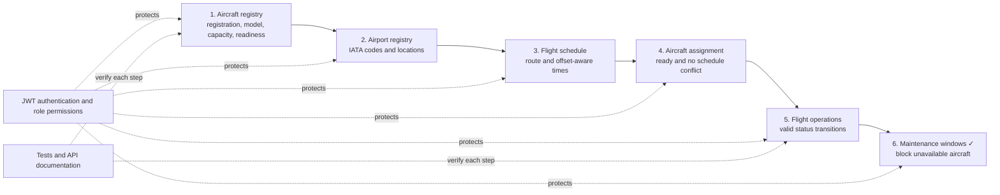
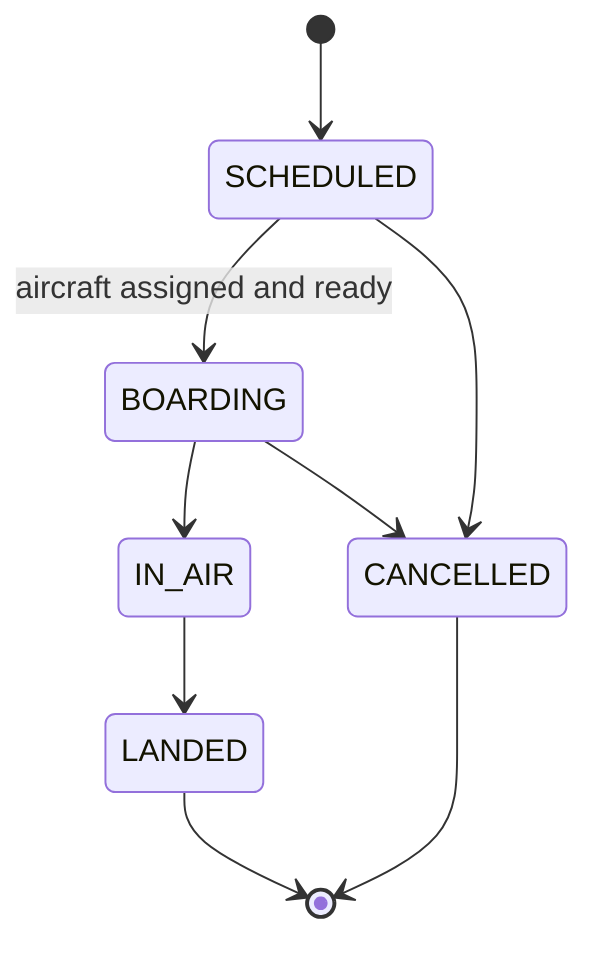

# AeroOps build flow

AeroOps is being developed as a learning project for airline operations. The first business workflow is keeping an aircraft fleet ready for scheduled flights.

## Milestones

- [x] Clone and map the existing employee-management backend.
- [x] Add aircraft registration, listing, details, updates, and readiness status.
- [x] Add airport records and validation.
- [x] Add flight scheduling and route/time validation.
- [x] Assign aircraft while rejecting unavailable or overlapping schedules.
- [x] Add allowed flight status transitions.
- [x] Add maintenance windows that block overlapping flights and assignments.
- [x] Align permissions and add workflow-focused tests and API documentation.

- [ ] Run integration checks against PostgreSQL, including real row-lock behavior under concurrent assignment requests.

Each milestone should leave the application buildable. Existing employee endpoints remain available during the migration and can be removed or retained after the aviation workflow is established.

## Flight status lifecycle

